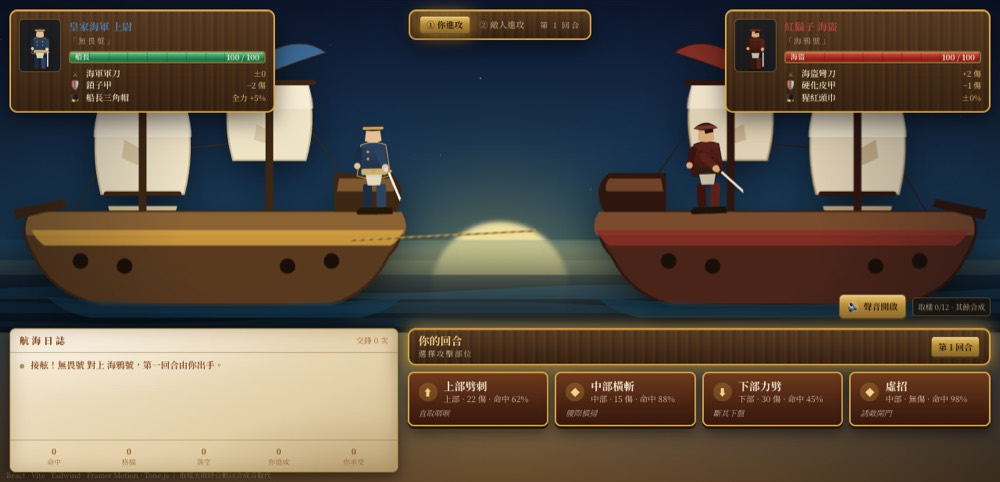
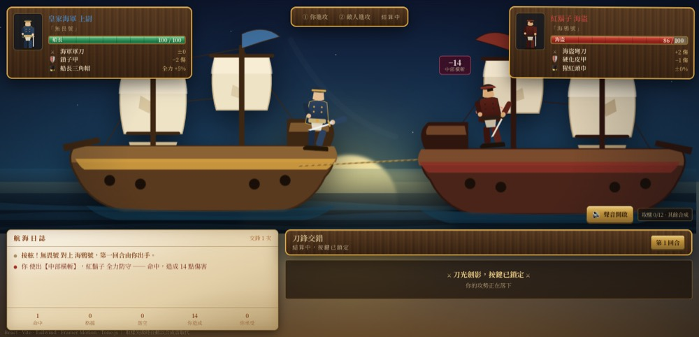
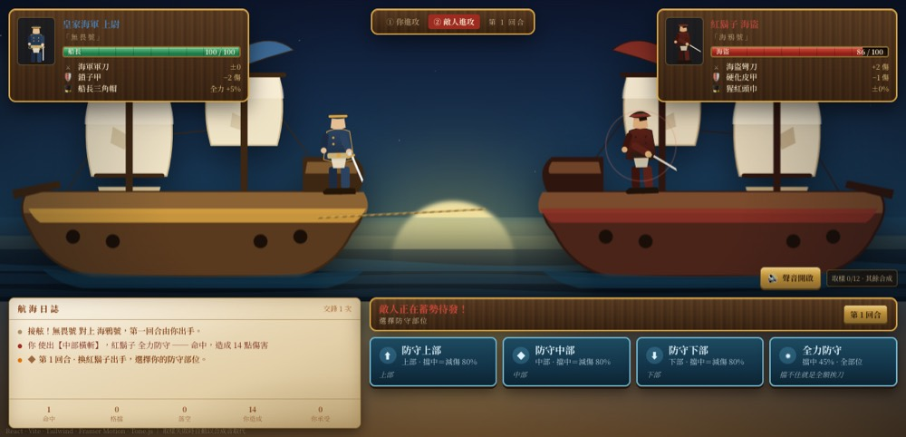
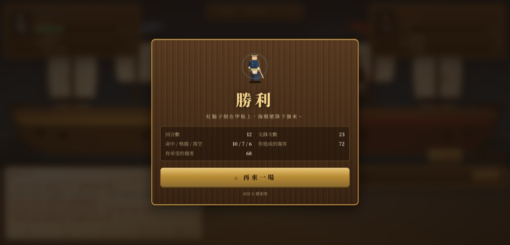
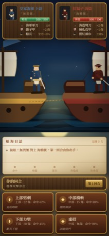

# 接舷單挑 · Close Quarters

> 一艘船、一個人、兩個階段，輪流交換。

十六世紀大航海風格的 2D 回合制單挑遊戲。兩艘船並排靠上，船長與海盜在甲板上對刀：
**你進攻時他防守，他進攻時你防守**，直到有人倒在自己的甲板上。

技術上它是一台很小的狀態機、一層薄薄的 React，加上一組即時合成的音效。
沒有伺服器、沒有圖檔、沒有音檔：船的帆、刀光、海面與每一聲鏗鏘都是程式畫出來、
算出來的。

```bash
npm install
npm run dev            # 開發伺服器
npm test               # 59 個純邏輯/音效測試（Node，不需要瀏覽器）
npm run test:browser   # 37 項瀏覽器實測（headless Chrome，會存截圖）
```

> **線上版**：`gh-pages` 分支已放好打包好的成品（相對路徑，可掛在 `/sailor/` 之下）。
> 只要在 GitHub 的 Settings → Pages 把 Source 指到 `gh-pages` /`(root)`，
> 就會在 <https://morattiyau-ctrlww.github.io/sailor/> 上線。

三次連拍：你的回合 → 結算鎖定 → 敵人的回合（都是 headless Chrome 實測截圖）

| ① 你的回合 | ② 刀光劍影（按鍵鎖定） | ③ 敵人的回合 |
| --- | --- | --- |
|  |  |  |

| 開場 | 分出勝負 | 手機版（390×844） |
| --- | --- | --- |
|  |  |  |

---

## 玩法

一場單挑分成兩個階段，一回合交換一次：

| 階段 | 誰出手 | 你要做的事 |
| --- | --- | --- |
| ① 你進攻 | 你 | 從四種攻擊選一招；**紅鬍子同時決定要守哪裡** |
| ② 敵人進攻 | 紅鬍子 | 他先「蓄勢待發」；你猜他要砍哪個部位並防守 |
| 結算 | 沒人 | 刀光劍影，**所有按鍵鎖定**（1150 ms） |

**判定**：攻擊部位與防守部位相同 → 格擋，減傷 80%；沒擋中就是實打實的一刀。
規則是對稱的——你在階段一遇到「全力防守」會很頭痛，因為那正是他在階段二最愛用的招。

**四種攻擊**（部位 · 傷害 · 命中率）

| 招式 | 部位 | 傷害 | 命中 | 特色 |
| --- | --- | --- | --- | --- |
| 上部劈刺 | 上部 | 22 | 62% | 高傷、中等命中，直取咽喉 |
| 中部橫斬 | 中部 | 15 | 88% | 穩定輸出，腰際橫掃 |
| 下部力劈 | 下部 | 30 | 45% | 一擊定生死，斷其下盤 |
| 虛招 | 中部 | 0 | 98% | **誘敵開門**：騙到之後，下一擊格擋 −20%、傷害 +25%（用掉即失效） |

**四種防守**：防守上部／中部／下部（對上該部位必定格擋）、全力防守（全部位 45% 格擋率）。

每次攻擊都有**命中判定**，所以「低命中」不是形容詞：下部力劈有四成半的機會揮空，
而虛招幾乎一定「騙到」，只是騙到不等於打傷。裝備也真的在算：海盜的彎刀 +2 傷害、
你的鎖子甲 −2 傷害、船長三角帽讓全力防守多 5%——面板上寫的數字就是戰鬥中用的數字。


---

## 架構

```
src/game/        純核心：沒有 React、沒有 DOM、沒有 Tone
  constants.js     所有數字（招式表、裝備、規則參數、動畫節奏）
  rules.js         種子隨機、傷害/格擋/命中計算、敵人的決策
  reducer.js       狀態機：PHASE{INTRO,PLAYER_ATTACK,RESOLVING,ENEMY_ATTACK,VICTORY,DEFEAT}
src/audio/       聲音：manifest（清單）→ cues（事件→聲音的純函式）→ sfx（Tone.js）
src/hooks/       useBattle.js：把狀態機接上計時器、音效與瀏覽器手勢
src/components/  8 個元件（BattleScene / Pirate / Ship / UIPanel / ActionBar / BattleLog …）
```

三個刻意的設計決定：

1. **狀態機就是規格。** 非法動作不是「被 UI 藏起來」，而是回傳**同一個 state 物件**；
   測試用 `toBe` 驗證它連參考都沒換，所以「結算中按攻擊」在資料層就不存在。
2. **每一顆隨機數都經過 state 傳遞**（`rng` 是一個普通數字）。同一顆種子可以完整重播整場單挑，
   而且能在 Node 裡跑到終局——音效測試正是靠這一點，用 220 場真實對戰去對帳聲音清單。
3. **音效沒有「找不到」的可能。** `cues.js` 是純函式，測試會把整場戰鬥會發出的每個聲音
   跟 `manifest.js` 對帳：每個聲音不是有取樣就是有合成配方，否則測試失敗。

---

## 聲音

沒有音檔進版控。每次發聲都是二選一：CDN 上的真實錄音，或 Tone.js 的即時合成。

| 事件 | 聲音 | 來源 |
| --- | --- | --- |
| 出手 | 破風 | **合成**（白噪掃頻比任何錄音都更像刀鋒） |
| 格擋 | 鏗鏘 | Berklee 取樣庫（tonejs.github.io） |
| 命中 | 重擊 + 咬刀 | Phaser 3 examples 取樣 |
| 倒地 | 死亡悶響 | Phaser 3 examples 取樣 |
| 蓄勢待發 | 低頻上揚 | **合成** |
| 新回合 | 船鐘 | **合成** |
| 你受傷 | 悶哼 | **合成** |
| 勝利／戰敗 | 號角／送葬 | **合成**（D 小調） |
| 上船 | 霧號 | Berklee 取樣庫 |
| 海面 | 風聲與浪 | **合成**（常駐氛圍，分出勝負後安靜下來） |

實測（headless Chrome，正常網路）：**12 種聲音裡 6 種載入真實錄音
（block / hit / click / defeat / death / foghorn），其餘走合成**；把 CDN 拔掉也一樣聽得見，
因為每種聲音都有合成配方（測試會強制這件事）。音效鈕旁邊會顯示「取樣 6/12 · 其餘合成」，
不讓玩家猜。

音效必須從**一次真實點擊**開始（瀏覽器政策），所以「⚔ 登船開戰」按下去的那一刻才建立
AudioContext——這也是整場唯一的技術性限制。

---

## 檢查（都是實測數字，不是形容詞）

**`npm test` — 59 個，全部在 Node 裡跑，不需要瀏覽器**

| 檔案 | 數量 | 在測什麼 |
| --- | --- | --- |
| `tests/rules.test.js` | 27 | 種子重播、傷害/格擋/命中公式、虛招、敵人的決策不會一直打同一個部位 |
| `tests/reducer.test.js` | 21 | 狀態機的合法/非法轉移（非法＝同一個物件，`toBe`）、傷害上限、交鋒統計 |
| `tests/audio.test.js` | 11 | 用 220 場真實對戰收集所有聲音，對帳 manifest 與合成配方 |

寫測試時抓到兩個真的 bug：`baseDamage` 讓虛招吃到了刀刃傷害；`chooseEnemyAttack` 專門打你
**最常守**的部位（現在會把「你守過的地方」的暴露度乘 0.55，免得他變成讀心機器）。

**`npm run test:browser` — 37 項，headless Chrome 走 DevTools protocol**

它操作真實頁面：按「登船開戰」→ 按「中部橫斬」→ 看著按鈕消失 → 等他反擊 → 按「防守下部」，
每一步都數畫面上的按鈕、截一張圖，並且**真的把一場打到分出勝負**（實測 21 次交鋒後勝利）：

- 你的回合：**4 個攻擊鈕、0 個防守鈕**（不是灰掉，是根本不存在）
- 敵人的回合：**0 個攻擊鈕、4 個防守鈕**，標題寫著「敵人正在蓄勢待發！」
- 結算中：**0 個**，並顯示「刀光劍影，按鍵已鎖定」
- 打完 21 次交鋒 → 勝利字牌、統計數字、再來一場把血條洗回 100/100
- 390×844 手機尺寸：兩艘船的船首仍然靠在一起、四個按鈕都在畫面上可點、沒有橫向或縱向溢出
- 全程 **0 個 console 錯誤、0 個例外**

截圖會存在 `/tmp/sailor/`（`01-start` … `07-phone`）。

---

## 已知限制

- 音效要按過「⚔ 登船開戰」才會響：瀏覽器不允許沒有互動就播音，這是政策不是懶惰。
- 取樣來自兩個公開 CDN；若離線或被擋，聲音會自動退回合成（聽起來不一樣，但事件不會消失）。
- 這一版沒有存檔、沒有難度選項、沒有連線；重新整理就是新的一局（種子會換）。

## 素材出處

- 音效取樣：[tonejs.github.io/audio](https://tonejs.github.io/audio)（Berklee 取樣庫）、
  [Phaser 3 examples](https://github.com/photonstorm/phaser3-examples) `assets/audio/SoundEffects`
- 其餘全部即時合成：Tone.js（FM 金屬、噪音、號角）
- 字體：Noto Serif TC（Google Fonts）；木紋、羊皮紙與海面都是 CSS
- 船、人物、刀光、浪：手寫 SVG（`Ship.jsx` / `Pirate.jsx` / `BattleScene.jsx`）

